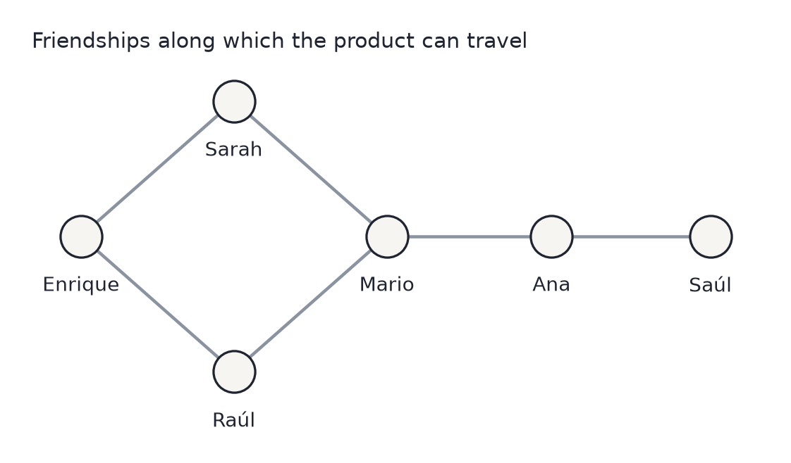
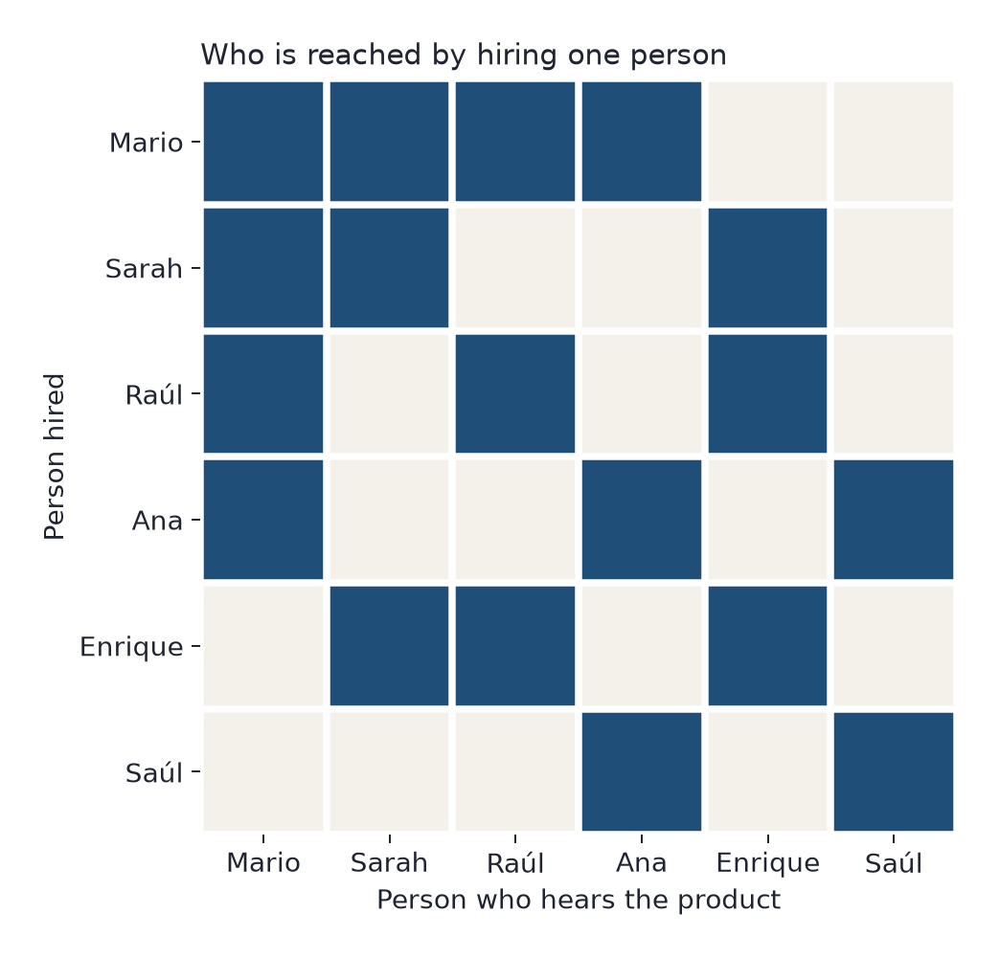
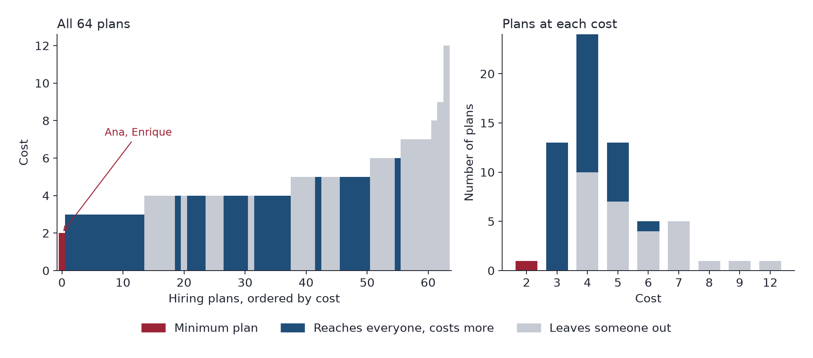
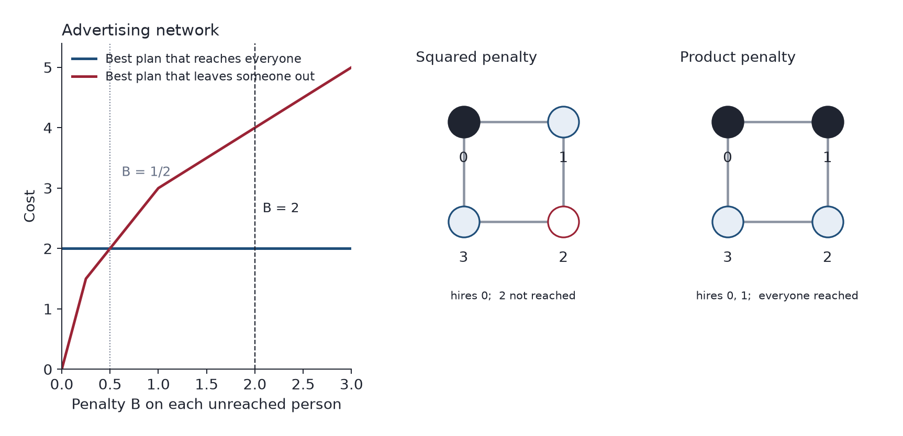
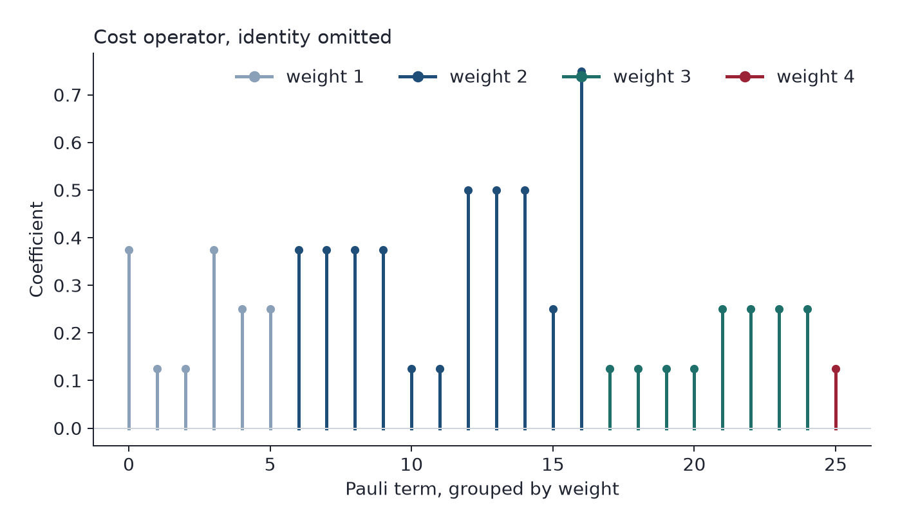
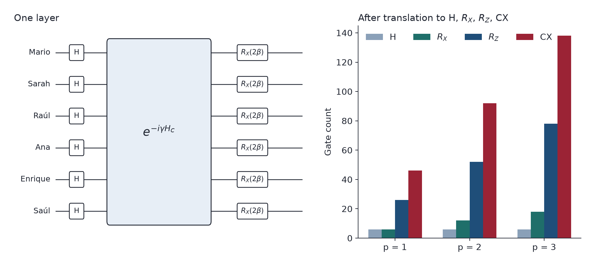
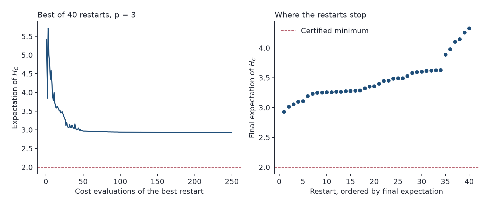
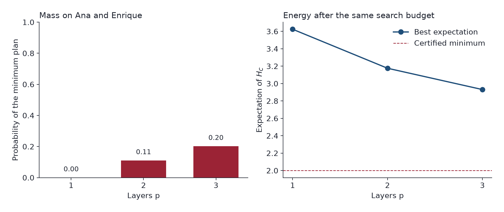
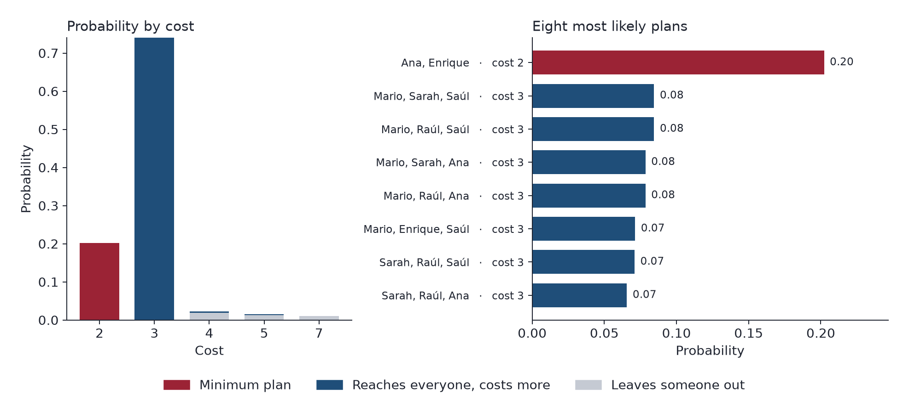
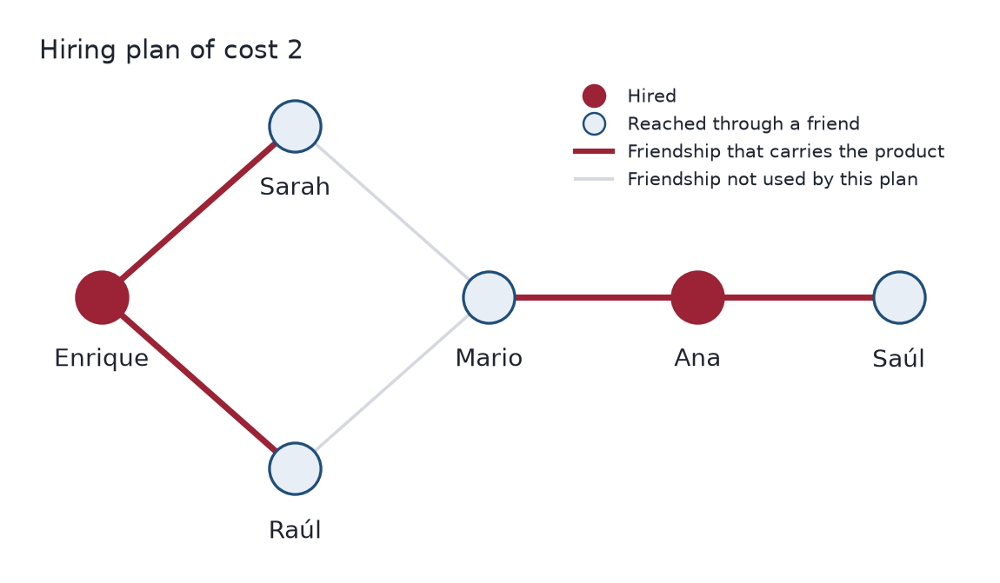

# Who carries a product through a six-person network: a quantum QAOA calculation

One-hop coverage on a six-vertex undirected graph is a minimum dominating set. The cost counts selected vertices and adds a penalty for each vertex with an empty closed neighborhood. The polynomial is the diagonal of a Pauli Hamiltonian, and its expectation is minimized by the quantum approximate optimization algorithm (QAOA).

## The network

Mario is friends with Sarah, Raúl and Ana. Enrique is friends with Sarah and Raúl. Saúl is friends with Ana. Every friendship runs in both directions, so the relation is an undirected edge.



Information stops after one hop. Paying Mario informs Mario, Sarah, Raúl and Ana, and nobody else. Enrique and Saúl stay unreached, and they are not friends with each other, so no single person on the left of the graph can finish the job that Mario leaves open.

The closed neighborhood of a person $v$ is that person together with their friends,

$$N[v] = \{v\} \cup \{u : \{u, v\} \in E\}.$$

Hiring $v$ covers exactly $N[v]$.



The matrix is the whole diffusion rule. The diagonal is dark because a hired person hears the product. Mario's row is the longest and still misses two columns, Enrique and Saúl. Ana's row covers Mario, Ana and Saúl. Enrique's row covers Sarah, Raúl and Enrique. Those two rows are disjoint and together they darken every column. No row does that alone.

## What a hiring plan costs

Let $x_v = 1$ when person $v$ is hired. With one unit of cost per hire and a penalty $B$ for each person left unreached,

$$C(\mathbf{x}) = \sum_v x_v + B \sum_v \prod_{u \in N[v]} (1 - x_u).$$

The product equals 1 only when every variable in $N[v]$ is 0, so a plan that reaches everyone pays only for the people it hires. The case uses $B = 2$.

There are $2^6 = 64$ plans. Scoring all of them fixes the minimum before any circuit is run.



One plan costs 2: hire Ana and Enrique. Thirteen plans cost 3, and every one of them reaches everyone. The gap above the minimum is a single hire, and it is crowded. Fourteen further dominating sets cost 4. Incomplete plans start at cost 4 as well: the cheapest way to leave someone out, under $B = 2$, is already as expensive as hiring four people who cover the network.

A greedy pass explains why the minimum is easy to miss. At each step it hires the person who still reaches the most unreached people, and breaks ties toward the earliest name in the order Mario, Sarah, Raúl, Ana, Enrique, Saúl. Mario's closed neighborhood is the unique largest, so the pass opens with Mario. Enrique and Saúl are both still unreached, and no remaining person reaches both. The pass then takes Sarah and Ana. The result, Mario, Sarah and Ana, is a dominating set of size 3. It is one of the thirteen plans at cost 3. The vertex that covers the most people is not in the minimum.

## The penalty has to price a missed person

$B$ does not change the order of the plans that already reach everyone: those pay exactly their number of hires. It decides whether an incomplete plan can undercut them.



On this network the curves meet at $B = 1/2$. Hiring only Mario costs $1 + 2B$, because two people, Enrique and Saúl, never hear the product. The minimum complete plan costs 2. Those are equal at $B = 1/2$, so Mario alone ties Ana and Enrique. For every larger penalty the unique minimum is Ana and Enrique. $B = 2$ sits above that crossing: leaving one person out costs as much as two hires the company did not need.

The right-hand graphs are a 4-cycle, where the shape of the penalty matters. The squared penalty

$$\sum_v \left(1 - \sum_{u \in N[v]} x_u\right)^2$$

is zero only when each person is reached by exactly one hire. Its ground states on the cycle hire a single vertex. The opposite vertex is not a friend of that vertex, so the product never arrives. The product penalty used above has ground states that hire two vertices, and every such pair reaches the cycle.

On the advertising network the two penalties share the ground state. Ana and Enrique cover each person exactly once, so the squared penalty also equals 2 there, and the next dominating set under that penalty costs 7. The extra gap is a charge for being reached twice. The diffusion rule has no such charge. The product is the bill the company pays.

## The cost, written as an operator

On a computational-basis state the substitution

$$x_q = \frac{I - Z_q}{2}$$

turns $C$ into a diagonal operator $H_C$. A product of variables becomes a product of factors $(I - Z)/2$, so the Pauli strings have weight at most $\lvert N[v]\rvert$. Qubit $q$ is person $q$. No slack qubits are added. The identity coefficient is $4.625$, a shift shared by every plan; the figure leaves it out. Shifting every plan by the same amount does not change which plan is cheapest, and it does not change the QAOA layers beyond a global phase.



Six terms have weight 1, eleven have weight 2, eight have weight 3, and one has weight 4. The weight-4 string sits on Mario, Sarah, Raúl and Ana, the only closed neighborhood of size 4. Evaluated on all 64 basis states, the diagonal of $H_C$ agrees with $C(\mathbf{x})$.

## Three layers of QAOA

QAOA prepares, at depth $p$,

$$\lvert\boldsymbol{\beta}, \boldsymbol{\gamma}\rangle = \prod_{\ell=1}^{p} e^{-i \beta_\ell H_M}\, e^{-i \gamma_\ell H_C}\, \lvert+\rangle^{\otimes n}, \qquad H_M = \sum_q X_q.$$

$H_C$ in the circuit is the non-identity part of the cost operator. Each mixer rotation is $R_X(2\beta)$, because $R_X(\theta) = e^{-i \theta X / 2}$.



The six Hadamard gates prepare $\lvert+\rangle^{\otimes 6}$ and are not repeated. Each added layer contributes mixer $R_X$ gates and a cost-layer expansion into $R_Z$ and CX. At three layers the translated circuit contains 6 Hadamards, 18 $R_X$, 78 $R_Z$ and 138 CX gates.

The angles are chosen by minimizing the exact expectation of $H_C$ in the statevector of the circuit. Each restart draws $\beta \in [0, \pi]$ and $\gamma \in [0, 2\pi]$, then runs COBYLA for up to 250 evaluations. The run uses 40 restarts and seed 7, the same budget at every depth.



The best restart drops and then flattens near $2.93$. The certified minimum is 2. Every restart stops above it. The search is not sitting one unlucky start away from a state whose energy is the ground cost. The state it can prepare, at this depth and with this search, is a mixture.

## What a further layer changes



One layer puts probability $0.0002$ on Ana and Enrique. It already puts probability $0.92$ on plans that reach everyone: the feasible region is found, the minimum inside it is not. Two layers raise the minimum to probability $0.11$ and the best expectation to $3.18$. Three layers reach probability $0.20$ and expectation $2.93$, with probability $0.95$ on complete plans. Each added layer, under this budget, lowers the expectation and raises the share on Ana and Enrique.

## Where the probability sits



Probability $0.20$ sits on cost 2. Probability $0.74$ sits on cost 3. The tail beyond that is a few hundredths. The single most likely plan is Ana and Enrique. A shot drawn from the state is still more likely to land on some cost-3 plan than on the minimum, because thirteen plans share that shelf and together they hold most of the mass.

The bars just under the minimum come in pairs of equal height. Sarah and Raúl have the same friends, Mario and Enrique, so exchanging them is a symmetry of the network. The paired plans are images of each other under that exchange: Mario with Sarah and Saúl against Mario with Raúl and Saúl, and the same pattern with Ana in place of Saúl.

The distribution is the low end of the cost spectrum, read back as probabilities. Enumeration had already shown a unique plan at cost 2 and a crowd at cost 3. The optimized state ranks that unique plan first and leaves the bulk of its probability on the crowd.

Keeping the cheapest plan among the samples returns Ana and Enrique. With probability $0.20$ on the minimum, the plan appears about once in every five shots.

## The hiring plan



| Person | How the product arrives |
| --- | --- |
| Mario | From Ana |
| Sarah | From Enrique |
| Raúl | From Enrique |
| Ana | Hired |
| Enrique | Hired |
| Saúl | From Ana |

Ana carries the product to Mario and to Saúl. Enrique carries it to Sarah and to Raúl. The edges Mario–Sarah and Mario–Raúl are real friendships. This plan does not use them: Mario already hears it from Ana, and Sarah and Raúl already hear it from Enrique.

Two people are enough, and the exhaustive score says they are the only pair that is enough.

## What this instance shows

The network has six vertices, so the ground state of $C$ is known by scoring every plan. The expectations and probabilities above are those of the ideal state prepared by the circuit, with no measurement noise and no device noise. Against that certified minimum, three layers of QAOA do two things that match the shape of the cost. They put the unique cheapest plan at the top of the distribution, and they leave most of the probability on the thirteen plans that hire one person more. The gap in the company's bill is one hire, and the state spreads across it.

## Reproducing the figures

The numbers in this note come from `results/case_study.json`. Redrawing the figures from that file does not rerun the search.

```bash
python -m venv .venv
source .venv/bin/activate
pip install -e ".[dev]"
pytest
python -m product_diffusion --replot results/case_study.json
```

Running `python -m product_diffusion` repeats the 40 restarts at depths 1, 2 and 3. The package splits the argument the same way the note does: `network` is the graph, `cost` is the polynomial, `hamiltonian` is its Pauli form, `classical` scores every plan and runs the greedy pass, `qaoa` builds the layers and the search.

## Sources

Farhi, E., Goldstone, J., and Gutmann, S. (2014). A Quantum Approximate Optimization Algorithm. arXiv:1411.4028.

Lucas, A. (2014). Ising formulations of many NP problems. Frontiers in Physics, 2, 5. The dominating-set encoding discussed there is the squared penalty. On this network that penalty has the same ground state; the cost used here is the product, which is zero for every complete plan.

## Archived statement

The problem statement and the written report are kept under their original filenames: [`act_3_grupal.docx`](docs/act_3_grupal.docx) and [`Alg_Cuánticos___Actividad_Grupal.pdf`](docs/Alg_Cuánticos___Actividad_Grupal.pdf).
